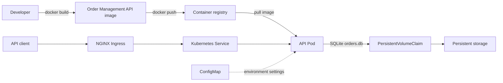

# Order Management

Order Management is a .NET 10 ASP.NET Core API starter organized into API, application, domain, and infrastructure layers.

## Prerequisites

- .NET 10 SDK (for local development)
- Docker Engine or Docker Desktop (for container builds and runs)
- For Kubernetes: `kubectl` configured for a cluster, a container registry account, a cluster StorageClass that can provision persistent volumes, and an NGINX Ingress Controller if you want to use the included Ingress

## Run locally with .NET

From the repository root:

```powershell
dotnet restore .\OrderManagement.slnx
dotnet build .\OrderManagement.slnx
dotnet run --project .\OrderManagement.API\OrderManagement.API.csproj
```

The API uses the configured ASP.NET Core development URL. Swagger is enabled only in the Development environment.

## Build and run with Docker

Run these commands from the repository root. The Dockerfile is at the repository root, and the build context must also be the repository root because the image builds the whole solution.

```powershell
docker build -f .\dockerfile -t ordermanagement-api:1.0 .
docker run --detach --name ordermanagement-api -p 8080:8080 `
  --mount source=ordermanagement-data,target=/app/data `
  -e "ConnectionStrings__DefaultConnection=Data Source=/app/data/orders.db" `
  ordermanagement-api:1.0
```

The named Docker volume keeps the SQLite database when the container is stopped or replaced. View logs and stop/remove the container with:

```powershell
docker logs --follow ordermanagement-api
docker stop ordermanagement-api
docker rm ordermanagement-api
```

The API listens on port `8080` in the container; the commands above expose it at `http://localhost:8080`.

## Deploy to Kubernetes

The manifests are in the repository-root `K8s` folder. The commands below use PowerShell and assume `kubectl` is pointed at the intended cluster. The cluster must be able to pull the image from Docker Hub and provision the included 1 GiB PersistentVolumeClaim.

### Build and push the image

Set your Docker Hub username, then build, authenticate, tag, and push the image:

```powershell
$env:DOCKERHUB_USERNAME = "your-dockerhub-username"
docker build -f .\dockerfile -t ordermanagement-api:1.0 .
docker login
docker tag ordermanagement-api:1.0 "$env:DOCKERHUB_USERNAME/ordermanagement-api:1.0"
docker push "$env:DOCKERHUB_USERNAME/ordermanagement-api:1.0"
```

### Apply the manifests

Apply the namespace before its namespaced resources. Update the image in `deployment.yaml` to the pushed image name, replacing `YOUR_DOCKERHUB_USERNAME` with your Docker Hub username. If using the Ingress, also change `orders.example.com` in `ingress.yaml` to a hostname that resolves to the cluster's ingress endpoint.

```powershell
kubectl apply -f .\K8s\namespace.yaml
kubectl apply -f .\K8s\configmap.yaml
kubectl apply -f .\K8s\persistent-volume-claim.yaml
kubectl apply -f .\K8s\deployment.yaml
kubectl apply -f .\K8s\service.yaml
kubectl apply -f .\K8s\ingress.yaml
```

The Ingress requires an NGINX Ingress Controller installed in the cluster. If you don't have one, skip applying `ingress.yaml` and use port forwarding to reach the API.

### Check and access the deployment

```powershell
kubectl get all,pvc,ingress -n ordermanagement
kubectl rollout status deployment/ordermanagement-api -n ordermanagement
kubectl logs -f deployment/ordermanagement-api -n ordermanagement
```

To access the API locally without an Ingress, run this in a separate terminal and use `http://localhost:8080`:

```powershell
kubectl port-forward service/ordermanagement-service 8080:80 -n ordermanagement
```

When using the Ingress, configure DNS (or a local hosts-file entry) for the hostname you set in `ingress.yaml` to point to the cluster's ingress endpoint.

### Remove the Kubernetes deployment

This deletes the namespace and its resources, including the claim to the SQLite volume:

```powershell
kubectl delete namespace ordermanagement
```

## Architecture



Within the API pod, requests pass through the API, application, domain, and infrastructure layers. The ConfigMap supplies the production environment and SQLite connection string; the PersistentVolumeClaim retains the database file independently of the pod.

## Project structure

```text
OrderManagement/
├── K8s/
├── OrderManagement.API/
├── OrderManagement.Application/
├── OrderManagement.Domain/
├── OrderManagement.Infrastructure/
├── OrderManagement.slnx
├── dockerfile
├── .dockerignore
└── Readme.md
```

## License

This project is provided as a starter solution for order management development.
