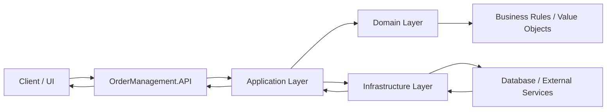

# Order Management

Order Management is a .NET solution designed to provide a clean foundation for managing order-related workflows, business rules, and API interactions.

## Overview

This repository is structured around a layered architecture to separate concerns and keep business logic maintainable:

- `OrderManagement.API` – ASP.NET Core web API entry point
- `OrderManagement.Application` – application services and use cases
- `OrderManagement.Domain` – domain models, value objects, and business rules
- `OrderManagement.Infrastructure` – data access and external service implementations

## Tech Stack

- .NET 10
- ASP.NET Core
- C#

## Prerequisites

Before running the project, make sure you have the following installed:

- .NET 10 SDK
- An IDE such as Visual Studio 2022 or VS Code

## Getting Started

1. Clone the repository
2. Open the solution in your preferred IDE or terminal
3. Restore NuGet packages:

```bash
dotnet restore
```

4. Build the solution:

```bash
dotnet build
```

5. Run the API project:

```bash
dotnet run --project OrderManagement.API
```

The API will start using the configured ASP.NET Core defaults and can be accessed via the local development endpoint.

## Project Structure

```text
OrderManagement/
├── OrderManagement.API/
├── OrderManagement.Application/
├── OrderManagement.Domain/
├── OrderManagement.Infrastructure/
├── OrderManagement.slnx
├── Readme.md
└── .gitignore
```

## Workflow Diagram



This diagram shows the flow of an order request from the client through the API, into the application layer, where business logic is orchestrated, then into the domain for rules and validation, and finally to infrastructure for persistence or external integration.

## Notes

This project currently provides the application foundation and starter structure. You can extend the domain model, add service-layer logic, and implement order workflows as the system evolves.

## License

This project is provided as a starter solution for order management development.
